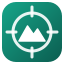
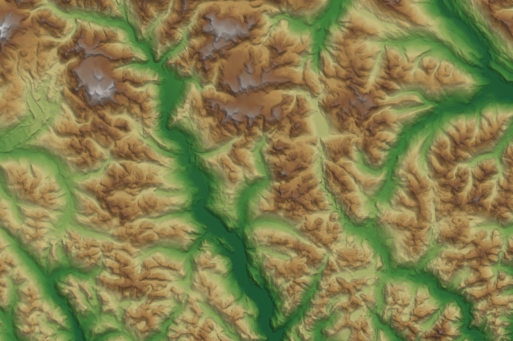

  

<h1 align="center">Datum</h1>

  <strong>Open geospatial data for QGIS, found and added without the hunt.</strong> 
  BC Data Catalogue · Open Government Canada · NRCan elevation · Sentinel-2 · USGS 3DEP · any CKAN or STAC catalogue

  
  
  
  

---

Finding open data usually means opening a portal in a browser, digging through dataset pages, working out which link is the WFS, copying it into QGIS and fixing the CRS. Datum does that from a panel inside QGIS. Search several catalogues at once, then double-click a result to add it as a live layer or as a download clipped to your map.

  
  
  

## Features

- **One search across many catalogues.** BC Data Catalogue, Open Government Canada, NRCan's GEO.ca datacube, Earth Search (AWS) and Microsoft Planetary Computer, plus any CKAN portal or STAC API you add. You can filter by format, organisation or the current map view, and sort the results.
- **Results that just work.** BC layers come in as live WFS in BC Albers, or as WMS. ArcGIS REST, WMTS, XYZ tiles, cloud-optimised GeoTIFFs and remote GeoJSON/KML/zipped shapefiles are detected and added with the right settings.
- **Quick add.** About 40 checked layers in one click: elevation models and hillshades, basemaps, imagery, BC water, roads, boundaries, parcels, forest cover, biogeoclimatic zones, wildfire perimeters, geology and place names.
- **Elevation builder.** Pick an area and get a DEM. *Auto* mode uses the finest model that actually has data there: HRDEM 1 m lidar, then MRDEM 30 m in Canada, then USGS 3DEP 10 m in the US, then Copernicus 30 m anywhere else. It clips, mosaics and reprojects, keeps the file under a size budget, and can add hillshade, slope, aspect, roughness, TRI, TPI and contours.
- **Imagery browser.** Search Sentinel-2 and any other STAC collection by area, date and cloud cover. Add true colour or single bands, mosaic the scenes, and optionally download them clipped to your area.
- **Add by URL.** Paste a service or file URL and Datum works out what it is. Paste a portal URL and it becomes a search source.
- **Library.** Favourites (with export and import) and a history of everything you've added.
- **No API keys, no tracking.** Datum talks only to the catalogues you enable (see [Privacy](#privacy)).

  
   MRDEM 30 m terrain with Datum's default colour ramp and blended multidirectional hillshade.

## Install

**From a release (recommended for now):**

1. Download `datum-<version>.zip` from the [latest release](https://github.com/thomasloydon/qgis-datum/releases/latest).
2. In QGIS, open **Plugins › Manage and Install Plugins › Install from ZIP**, choose the file and click **Install Plugin**.

**For development:** clone the repo and run `make deploy`, which links the plugin into your QGIS profile. See [docs/development.md](docs/development.md).

Datum needs QGIS 3.28 or newer on Windows, macOS or Linux, and is tested on the long-term-support, stable and nightly releases. It uses only what ships with QGIS (Python, PyQt, GDAL), so there's nothing extra to install.

## Quick start

1. Open Datum from the toolbar button, from **Web › Datum**, or with **Ctrl+Alt+D**.
2. Type what you're after (*streams*, *lidar*, *parcels*, *wildfire*) and press Enter.
3. Double-click a result to add it. You can also pick a specific resource in the details panel, or use **Download in view** to save just the features on screen.

To get terrain, open **Quick add › Elevation & terrain › Best available DEM for the map extent**, or use the **Elevation** tab for full control.

The [user guide](docs/user-guide.md) walks through every tab and option.

## Data sources

| Source | Coverage | What you get |
|---|---|---|
| [BC Data Catalogue](https://catalogue.data.gov.bc.ca) | British Columbia | 2,000+ BC Geographic Warehouse layers as live WFS/WMS, plus downloads |
| [Open Government Canada](https://open.canada.ca/data) | Canada | Federal datasets (NRCan, ECCC, StatCan…) as WMS, ArcGIS REST and files |
| [NRCan GEO.ca Datacube](https://datacube.services.geo.ca) | Canada | MRDEM, HRDEM lidar, CDEM/CDSM, land cover, surface water and air photos as COGs |
| [Earth Search](https://earth-search.aws.element84.com/v1) | Global | Sentinel-2, Sentinel-1, Copernicus DEM, NAIP |
| [Planetary Computer](https://planetarycomputer.microsoft.com) | Global | USGS 3DEP lidar DEMs, NASADEM, ALOS, Landsat, ESA WorldCover and more |
| Custom | Anything | Any CKAN portal or STAC API (Alberta, Ontario and HDX are one click away) |

Each dataset keeps its own licence, and Datum copies the licence and attribution into the layer metadata. See [docs/data-sources.md](docs/data-sources.md) for endpoints, licences and attribution requirements.

## Privacy

Datum has no telemetry and no accounts. It sends requests only to the catalogues and data hosts you use, and those servers see ordinary HTTP requests from your IP address, as they would from a browser. Requests go through QGIS's network stack, so your proxy and authentication settings apply. Favourites, history and settings stay in your QGIS profile.

## Documentation

- [User guide](docs/user-guide.md): every tab and option
- [Data sources](docs/data-sources.md): endpoints, coverage, licences, attribution
- [Development](docs/development.md): architecture, tests, adding a source
- [Releasing](docs/releasing.md): CI/CD, versioning, publishing
- [Changelog](CHANGELOG.md)

## Contributing

Bug reports, data-source suggestions and pull requests are welcome. See [CONTRIBUTING.md](CONTRIBUTING.md). Please report security issues privately, as described in [SECURITY.md](SECURITY.md).

## License

Copyright © 2026 Thomas Loydon. Datum is free software under the [GNU General Public License v2.0 or later](LICENSE), the same licence family as QGIS. Data you load through Datum is subject to its provider's own licence.
