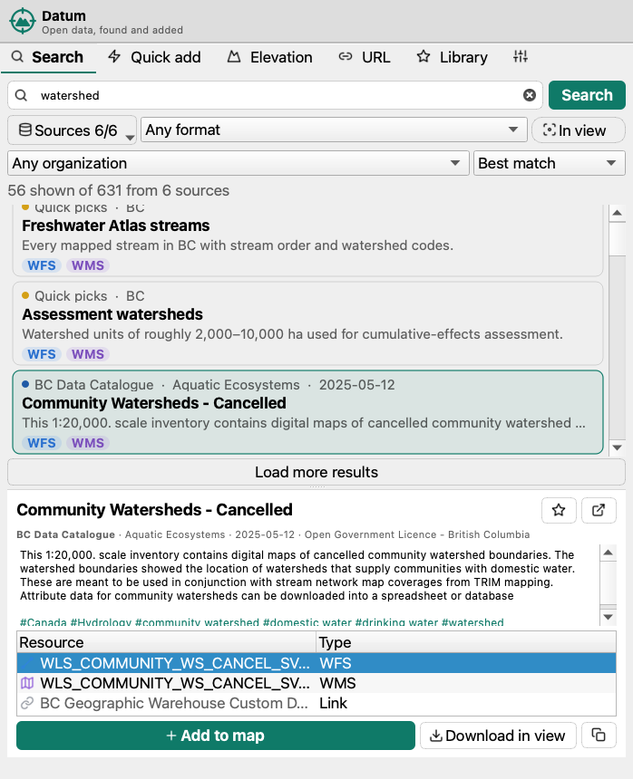
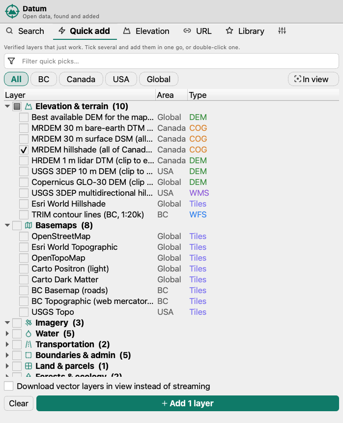
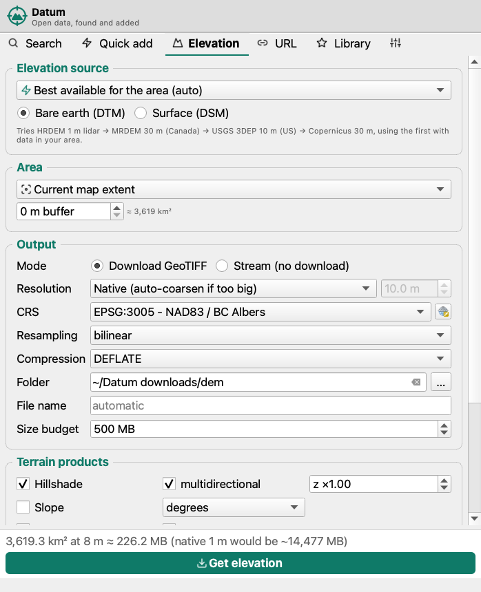
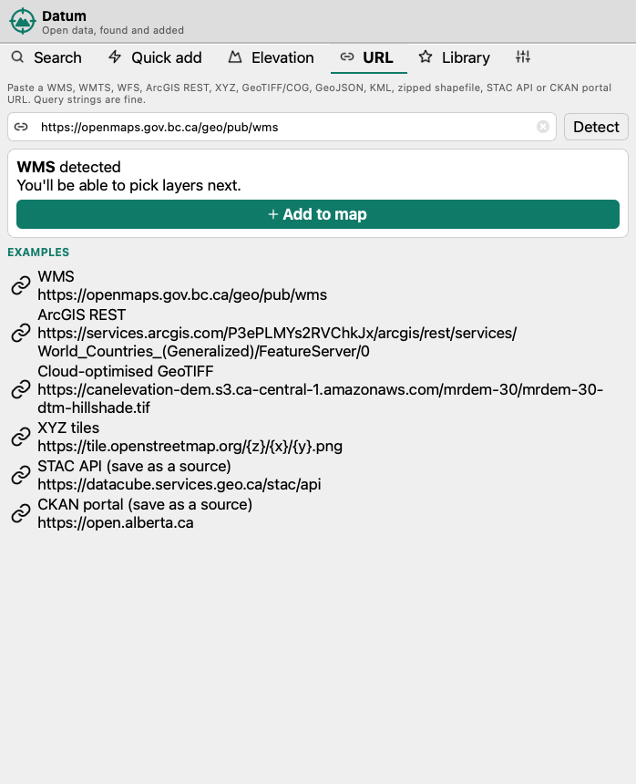

# User guide

Datum lives in a dock panel. To open it, click the toolbar button, choose **Web › Datum**, or press **Ctrl+Alt+D**, which opens the panel and puts the cursor in the search box. The panel has six tabs. This guide covers each of them in order.

- [Search](#search)
- [Quick add](#quick-add)
- [Elevation](#elevation)
- [Imagery (STAC) browser](#imagery-stac-browser)
- [Add by URL](#add-by-url)
- [Library](#library)
- [Settings](#settings)
- [Where layers go](#where-layers-go)
- [Troubleshooting](#troubleshooting)

---

## Search

Type a few words and press **Enter**. Every enabled source is searched in parallel, and results appear as each source answers. Each result is a card showing:

- a coloured dot and name for the **source**, plus the organisation, last update and coverage;
- the **title** and a one-line description;
- **chips** for what can be added: `WFS` live features, `WMS`/`Tiles` map images, `ArcGIS` services, `COG` streamed rasters, `Vector` files, `STAC` imagery collections, `DEM` elevation, and `Link` for things that only open in a browser.

### Filters

| Control | What it does |
|---|---|
| **Sources n/m** | Turn individual catalogues on or off. Your choice is remembered. |
| **Format** | Only show datasets that offer that kind of resource, e.g. *Live vector (WFS, ArcGIS)* or *Rasters, DEMs & imagery*. |
| **In view** | Only show datasets that overlap the current map extent. Open Canada and STAC sources filter on the server. The BC catalogue doesn't record extents, so its results aren't narrowed. |
| **Organization** | Filled in from the results. Picking one searches only that organisation in that portal. |
| **Sort** | Best match, recently updated, or title. |

Each source returns a page of results (25 by default, changeable in Settings). Click **Load more results** to fetch the next page from every source that has more.

### Adding a result

- **Double-click** a card to add its best resource. For BC datasets that's live WFS by default; you can change that in Settings.
- **Select** a card to open the details panel. It shows the full description, tags, licence and every resource. Pick a resource and click **Add to map**, or double-click it.
- **Download in view** saves the features inside the current map extent to a local file (GeoPackage by default) and adds that file. It appears for WFS, ArcGIS feature and vector-file resources.
- **★** adds the dataset to your favourites, and **↗** opens its page in your browser.
- **Right-click** a card or resource for the same actions, plus *Add as map image (WMS)*, *Copy URL* and *Open URL in browser*.

If a WMS, WMTS or WFS resource doesn't name a layer, or an ArcGIS service has several, Datum reads the service and asks which layers to add.

---

## Quick add

Quick add is a curated list of layers that are known to work, grouped by theme:

| Theme | Examples |
|---|---|
| Elevation & terrain | Best available DEM for the view, MRDEM 30 m DTM/DSM/hillshade (all of Canada, streamed), HRDEM 1 m, USGS 3DEP 10 m, Copernicus 30 m, 3DEP and Esri hillshades, TRIM contours |
| Basemaps | OpenStreetMap, Esri Topographic, OpenTopoMap, Carto light/dark, BC Basemap, BC Topographic, USGS Topo |
| Imagery | Esri World Imagery, Sentinel-2 cloudless, Sentinel-2 scenes in view |
| Water | Freshwater Atlas streams, lakes, rivers, wetlands, assessment watersheds |
| Transportation | Digital Road Atlas, forest tenure roads |
| Boundaries & admin | Municipalities, regional districts, Indian Reserves, parks and protected areas, Tree Farm Licences |
| Land & parcels | ParcelMap BC parcel fabric |
| Forests & ecology | Vegetation Resources Inventory, biogeoclimatic zones |
| Fire & hazards | Current and historical wildfire perimeters |
| Geology & mining | Bedrock geology, mineral tenures |
| Place names | BC Geographical Names |

- **Tick** several layers and click **Add n layers**. Basemaps are added first, so they end up underneath.
- **Double-click** any layer to add it straight away.
- Narrow the list with the filter box, the region chips (*BC* also shows Canada-wide and global layers), or **In view**.
- Tick **Download vector layers in view** to save WFS layers as local files clipped to the map extent instead of streaming them.

Some BC layers, such as VRI forest cover and parcels, are very dense. Zoom in before adding them, or use **Download in view**.

---

## Elevation

The Elevation tab builds a DEM for any area, with optional terrain products.

### Source

| Source | Resolution | Coverage | Surfaces |
|---|---|---|---|
| **Best available (auto)** | finest with data | Global | DTM (falls back to DSM) |
| HRDEM mosaic 1 m / 2 m (NRCan lidar) | 1 / 2 m | Canada, where lidar exists | DTM, DSM |
| HRDEM by lidar project | 1 m | Canada, individual surveys | DTM, DSM |
| MRDEM (NRCan) | 30 m | Canada | DTM, DSM |
| CDEM (NRCan, legacy) | ~20 m | Canada | DTM |
| USGS 3DEP seamless | ~10 m | United States | DTM |
| USGS 3DEP lidar DTM / DSM | 2 m | US, where lidar exists | DTM / DSM |
| Copernicus GLO-30 / GLO-90 | 30 / 90 m | Global | DSM |
| NASADEM, ALOS World 3D | 30 m | Global | DSM |

A **DTM** is bare earth; a **DSM** includes trees and buildings. In **auto** mode Datum tries HRDEM 1 m, then MRDEM 30 m, then 3DEP 10 m, then Copernicus 30 m. It checks each one for real data in your area before using it. For very large areas it skips 1 m lidar, which would be resampled to 30 m or coarser anyway.

When the HRDEM-by-project source has overlapping surveys, choose **Use the newest lidar project** or **Mosaic all projects (newest on top)**.

### Area

Choose the **current map extent**, the **extent of a layer**, the **selected features** of a layer, or **draw a rectangle** on the map. You can add a buffer in metres. The approximate area is shown next to it.

### Output

| Option | Notes |
|---|---|
| **Mode** | *Download GeoTIFF* clips, mosaics and reprojects into a local file, and is needed for terrain products. *Stream* creates a small VRT that reads the remote tiles as you pan: it's instant, but needs internet. |
| **Resolution** | *Native* uses the source's resolution and coarsens it to stay under the size budget. *Custom* lets you set metres per pixel. |
| **CRS** | The output projection; defaults to the project CRS. |
| **Resampling** | bilinear (default), cubic, nearest, average, cubic spline or Lanczos. |
| **Compression** | DEFLATE (default), LZW, ZSTD or none. Elevation uses a floating-point predictor. |
| **Folder / File name** | Defaults to `~/Datum downloads/dem` with an automatic name. An existing GeoTIFF is never overwritten; a number is added instead. |
| **Size budget** | Upper limit for the uncompressed DEM (500 MB by default). When coarsening is needed, Datum steps to 2×, 4×, 8×… the native resolution. Those steps line up with the overview levels stored in the source files, so large areas download much faster. |

The footer estimates the size before you start, e.g. *3,619 km² at 8 m ≈ 226 MB (native 1 m would be ~14,477 MB)*.

### Terrain products

Hillshade (optionally multidirectional, with a z-factor), slope (degrees or percent), aspect, roughness, terrain ruggedness (TRI), topographic position (TPI), and contours at any interval, saved to a GeoPackage. Each product is added as its own layer.

### Styling

By default the DEM gets a hypsometric colour ramp with a hillshade blended over it (a second copy of the layer drawn in *multiply* mode). You can also choose a plain hillshade renderer or greyscale, and turn the blend off.

### One-click DEM

**Quick add › Best available DEM for the map extent**, and the HRDEM, 3DEP and Copernicus quick picks, run the same builder on the current map extent with your saved defaults. For areas over about 25,000 km² they stream instead of downloading, so the layer appears in seconds; a message tells you when that happens. For a local GeoTIFF of a large area, use the Elevation tab.

---

## Imagery (STAC) browser

Adding a `STAC` resource, such as *Sentinel-2 scenes in view* or any STAC collection from Search, opens the imagery browser:

1. **Where:** the map extent, a layer, selected features or a drawn rectangle.
2. **When & filters:** an optional date range and maximum cloud cover. Both are on by default for optical imagery such as Sentinel-2, and the defaults are set in Settings.
3. **Search**, then select one or more items. They're sorted newest first and show cloud cover.
4. **Asset / band:** e.g. `visual` (true colour), single bands, or `dtm`/`dsm`/`data` for elevation collections.
5. Optionally **mosaic** the selected items into one layer, and/or **download** them clipped to the area.

Planetary Computer asset links are signed automatically, but the signatures expire after about an hour. Tick **Download** if you need the data later.

---

## Add by URL

Paste any of these and click **Detect**:

- WMS / WMTS / WFS endpoints, with or without `GetCapabilities` parameters
- ArcGIS REST `MapServer`, `FeatureServer` or `ImageServer` URLs, with or without a layer id
- XYZ tile templates such as `https://tile.openstreetmap.org/{z}/{x}/{y}.png`
- GeoTIFF / COG, GeoJSON, KML/KMZ, GeoPackage, FlatGeobuf, or zipped shapefile URLs
- a **CKAN portal** or **STAC API** root, which you can save as a search source

If the URL itself isn't conclusive, Datum fetches it and inspects the response. The examples list shows one of each type; click one to try it.

---

## Library

- **Favourites:** star datasets from Search to keep them here. Double-click to add. You can remove favourites, open their page, or **export/import** them as JSON, for example to share with a colleague.
- **Recent:** every layer you've added, newest first, including DEMs and downloads. Double-click to add it again.

---

## Settings

| Group | Options |
|---|---|
| Extra catalogues | Add a known portal (Alberta, Ontario, HDX) or any CKAN/STAC URL, or remove one. New catalogues appear in the Search tab's **Sources** menu. |
| Search | Results per source, network timeout, language for bilingual (English/French) portals. |
| Adding layers | Layer group name (blank means the top of the layer tree), a sub-group per source, zoom to new layers, copying description/licence/attribution into layer metadata. |
| Vector services | Default action for vector services: live WFS (loads what's in view), WMS map image, or download features in view. Optional maximum feature count. |
| Downloads | Folder and vector format (GeoPackage, GeoJSON, Shapefile). |
| Imagery search | Default look-back in days, maximum cloud cover and maximum items. |

**Clear cache** drops cached catalogue responses (kept for 10 minutes). **Reset to defaults** restores every setting but keeps your favourites and history.

---

## Where layers go

New layers go into a **Datum** group at the top of the layer tree, with basemaps at the bottom of it. You can rename or disable the group in Settings, or have a sub-group per source. Layer metadata (**Layer Properties › Metadata**) records the dataset's description, licence, publisher and a link to its source page.

Files are saved under `~/Datum downloads` (`dem/` for elevation, `stac/` for imagery) unless you choose another folder.

---

## Troubleshooting

| Symptom | What to try |
|---|---|
| A source shows **⚠ unavailable** in the status line | Hover over it to see the error. Catalogues occasionally go down; the other sources still work. Check your proxy under **Settings › Network** in QGIS. |
| A WFS layer looks empty | Live WFS only loads what's in view. Zoom to your area of interest. Some layers only cover part of BC. |
| A dense layer is slow | Zoom in first, set a **Max features** limit in Settings, or use **Download in view**. |
| A DEM came out coarser than expected | It hit the **Size budget**; the footer and the completion message show why. Raise the budget or shrink the area. |
| A DEM is blank in places | Lidar products only exist where surveys were flown. Use auto mode or MRDEM/Copernicus for full coverage. |
| Planetary Computer layers stop drawing | The signed links expired. Add them again, or download them. |

Datum logs details to **View › Panels › Log Messages › Datum**. Please include that log when you [report a bug](https://github.com/thomasloydon/qgis-datum/issues/new/choose).
